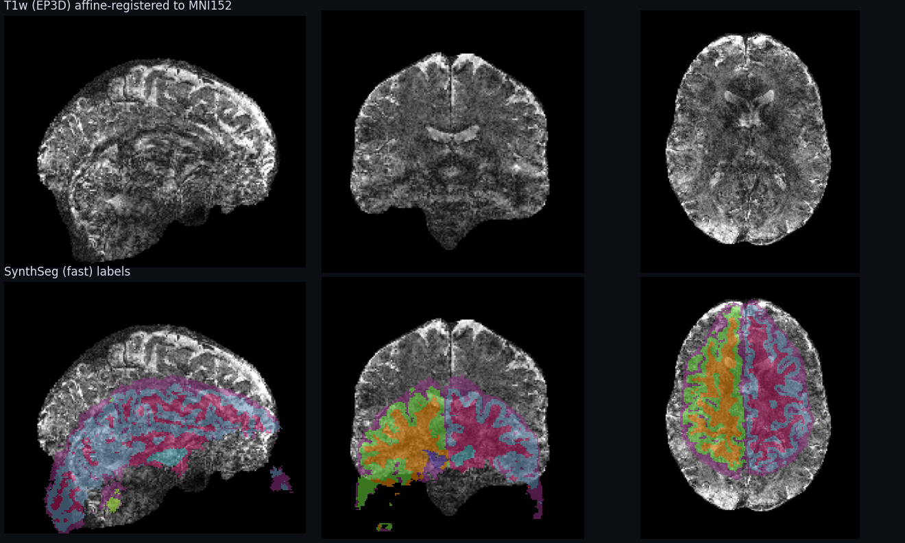

<!-- _class: lead -->

# NeuroFlow on a real scan

### Siemens XA DICOM → typed tools → provenance → a live desktop ingest

<small class="muted">Dataset: the presenter's own head, crlab generic protocol, 3 T MAGNETOM Vida · 2026-10-07</small>

---

## The dataset

One session, exported as Siemens **enhanced MR** multi-frame DICOM, 2.4 GB.

| Series (ReproIn names) | What it is | Files |
|---|---|---|
| `anat-scout_ses-1` + 3 MPR | localizer | 4 |
| `anat-T1w_acq-dzneEp3d…` ×4, `…dir-REV` ×4 | 0.35 mm 3D-EPI T1w, magnitude + phase, fwd + rev | 8 |
| `fmap_acq-ge_run-1` | gradient-echo field map, 2 echoes + phase | 3 |
| `func-bold_task-rest_acq-2d-1echo_run-1` (+SBRef, +Pha) | TR 1.02 s, 254 volumes | 510 |
| `func-bold_task-rest_acq-2d-2echo_run-2` (+SBRef, +Pha) | TR 1.53 s, 2 echoes, 340 volumes | 684 |
| `func-bold_task-rest_acq-2d-3echo_run-3` (+SBRef, +Pha) | TR 1.89 s, 3 echoes, 414 volumes | 834 |
| PMU / PhysioLog | cardiac + respiratory traces | in series |

2043 `MRe.*` image files + 38 `RAW.*` Siemens raw-data files. The names already follow ReproIn, so BIDSvue can map them without a heuristic file.

---

## Obstacle: JPEG Lossless, multi-frame

Transfer syntax `1.2.840.10008.1.2.4.70`, one encapsulated fragment per frame. Older `dcm2niix` builds stop at the first frame:

```
Error: Failed to decode frame 1/46 offset: 205288 bytes: 6978 format: 1.2.840.10008.1.2.4.70
Error: JPEG signature 0xFFD8FF not found at offset 205288 of .../MRe.1.3.12.2.1107.5.2.50.177514...
```

| Build on this Mac | Version | Result |
|---|---|---|
| FSL bundled (`~/fsl/bin`, was first on PATH) | v1.0.20250505 | <span class="bad">only physio sidecars</span> |
| MRIcroGL bundled | v1.0.20220720 | <span class="bad">fails</span> |
| Installed BIDSvue.app sidecar | v1.0.20260416 | <span class="bad">fails</span> |
| `bidsui` checkout sidecar (`resources/darwin`) | v1.0.20260520 | <span class="ok">36 series</span> |
| Homebrew `dcm2niix` | v1.0.20260724 | <span class="ok">36 series, now used</span> |

NeuroFlow's `dcm2niix` tool template already prefers `/opt/homebrew/bin`, so the fix was `brew install dcm2niix`. BIDSvue's dev build needed its gitignored sidecars staged from `resources/darwin/`.

---

## NeuroFlow in one slide

<div class="two">
<div>

**Documents** — every tool is a JSON doc with typed inputs/outputs (`neuro:dicom-folder`, `neuro:volume`, `neuro:label-map`, …) and a `neuroflow/launch` extension: `script` (headless) or `uiApp` (opens a window, waits).

**Workflows** reference tools by id and wire outputs to inputs by type.

**Runtime** (`neuroflow-mcp`, Rust) runs a workflow step by step in its own session folder and writes provenance.

</div>
<div>

**Two hosts, one runtime**

- MCP server (stdio) → agents like Claude Code run tools and workflows headlessly. `interactive: false`, so `uiApp` steps are refused up front.
- Desktop builder (Tauri) → canvas, environment check, Run panel with Cancel. `interactive: true`, so BIDSvue and NeuroVue can be launched and waited on.

Every run lands in `~/.neuroflow/runs/<run-id>/` with `run.json`, `provenance.jsonl`, `run.provenance.json`, `outputs/<step>/`, `logs/<step>/`.

</div>
</div>

---

## Headless run 1 — convert everything

Claude Code called the `dcm2niix` tool through the MCP server on the **original** folder:

| | |
|---|---|
| Run | `run-20261007T131851Z-f669` |
| Input | the 2.4 GB DICOM folder, untouched |
| Output | 36 NIfTI volumes + sidecars, 61 s |
| Sidecar says | `"ConversionSoftwareVersion": "v1.0.20260724"` |

The tool contract returns the first volume as `neuro:volume` and its sidecar as JSON. Provenance records the tool, its version and the host.

---

## Headless run 2 — `dicom-t1-mni-volumes`

Input: series 5 only (T1w magnitude, 500 × 600 × 416 at 0.35 mm). Template: `MNI152_T1_1mm_brain`. Mode: `fast`.

| Step | Tool | Time |
|---|---|---|
| convert | `neuroflow.gallery.tools/dcm2niix` | 5 s |
| strip | `neuroflow.gallery.tools/mindgrab` (brainchop CLI) | 9 s |
| register | `neuroflow.gallery.tools/niimath-allineate` | 4 s |
| segment | `neurodesk.webapps/synthseg` | 6 s |
| volumes | `neuroflow.gallery.tools/label-volumes` | < 1 s |
| **total** | `run-20261022T140410Z-6b3e`, status **completed** | **24 s** |

Outputs: `t1`, `brain`, `brain_mask`, `brain_mni`, `to_mni`, `labels`, `volumes` (TSV + JSON table). The recorded run was replayed through the same MCP server by a small stdio client (`crlab-demo`); its provenance carries a sha256 for every file and folds each tool's trail.

---

## Result, and an honest QA flag



---

## What the numbers say

<div class="two">
<div>

| Structure | mL |
|---|---|
| Left / Right cerebral WM | 161 / 153 |
| Left / Right cortex | 199 / 200 |
| Lateral ventricles | 7.9 / 6.4 |
| CSF | 200 |
| Cerebellum cortex L / R | 6.1 / 1.9 |
| Thalamus L / R | 0.4 / 1.2 |
| Hippocampus R | 0.3 |

<small class="muted">`out/volumes.tsv`, voxel 1 mm³ in MNI space</small>

</div>
<div>

**The pipeline ran. The anatomy is not trustworthy.**

- The input is a 3D-EPI T1w (DZNE `dzne_ep3d`), not an MPRAGE: noisy, low GM/WM contrast, EPI distortion.
- Brain extraction and the affine to MNI are visibly off; SynthSeg `fast` labels only part of the cerebrum and almost no cerebellum or deep grey.
- Labelled 939 mL vs. brain mask 1617 mL says the same thing.

This is exactly what the **Explore** stage is for: review in NeuroVue before any number is published.

</div>
</div>

---

## The interactive workflow: `dicom-ingest-review-publish`

| # | Step | Tool | Stage | Completes when |
|---|---|---|---|---|
| 1 | `ingest` | **BIDSvue** (`uiApp`, `bun tauri dev` in `../bidsui`) | Ingest | app closed, `bids_dir` written |
| 2 | `review` | **NeuroVue** (`uiApp`, `../neurovue`) | Explore | `correction_patch` saved (`outputsAvailable`) |
| 3 | `filter` | `python-volume-filter` (smooth 3) | Explore | process exits |
| 4 | `qa` | `niivue-qa-page` | Publish | process exits |

The runtime passes each app a session: `NEUROFLOW_SESSION/context.json`, `NEUROFLOW_OUTPUT_DIR`, and appends to `provenance.jsonl`. Each step runs in its own process group, so **Cancel** in the Run panel stops the whole tree.

---

## Live demo

<div class="demo-box">
  <button id="launch" type="button">Launch NeuroFlow desktop</button>
  <button id="stop" type="button" class="secondary">Stop</button>
  <div class="status" id="status">Checking host…</div>
  <div style="margin-top:10px">Workflow <code>dicom-ingest-review-publish</code> · set <code>dicom_dir</code> to
    <span class="path" id="dicom">(start <code>serve.mjs</code> with <code>--dicom</code>)</span>
    <button id="copy" type="button" class="secondary" style="font-size:16px;padding:4px 10px">copy</button>
  </div>
  <pre id="log" hidden></pre>
</div>

1. **Environment** panel: `dcm2niix v1.0.20260724` ready; `bidsvue`, `neurovue` ready (checkouts found next to this repo).
2. **Library** → `dicom-ingest-review-publish` → paste `dicom_dir` → **Run**.
3. BIDSvue opens on the DICOM folder: ReproIn names map straight to BIDS. Finish, close.
4. NeuroVue opens on the new BIDS dataset: review, save corrections. The step completes on save while the app stays open.
5. Filter and QA run headless; the Run panel lists outputs with **Open** and the run folder.

<script>
(() => {
  const $ = (id) => document.getElementById(id);
  const status = $('status'), log = $('log'), launch = $('launch'), stop = $('stop');
  let dicom = '';
  async function api(path, method = 'GET') {
    const res = await fetch(path, { method });
    if (!res.ok) throw new Error(`${path}: ${res.status}`);
    return res.json();
  }
  async function refresh() {
    try {
      const s = await api('/status');
      const label = { running: 'NeuroFlow desktop is running', starting: 'Starting (compiling the Tauri host)…', stopped: 'Not running', failed: 'Launch failed, see log' }[s.state] ?? s.state;
      status.textContent = `${label}${s.pid ? ` · pid ${s.pid}` : ''}${s.external ? ' · started outside this page' : ''}`;
      launch.disabled = s.state === 'running' || s.state === 'starting';
      stop.disabled = !(s.ownsProcess && (s.state === 'running' || s.state === 'starting'));
      if (s.tail && s.tail.length) { log.hidden = false; log.textContent = s.tail.join('\n'); log.scrollTop = log.scrollHeight; }
    } catch (err) {
      status.textContent = 'Serve this deck with demos/crlab-ingest/serve.mjs to launch the app from here.';
      launch.disabled = stop.disabled = true;
    }
  }
  api('/config').then((c) => { if (c.dicomDir) { dicom = c.dicomDir; $('dicom').textContent = c.dicomDir; } }).catch(() => {});
  launch.onclick = async () => { launch.disabled = true; status.textContent = 'Launching…'; try { await api('/launch', 'POST'); } catch (e) { status.textContent = String(e); } refresh(); };
  stop.onclick = async () => { try { await api('/stop', 'POST'); } catch (e) { status.textContent = String(e); } refresh(); };
  $('copy').onclick = async () => { if (dicom) { await navigator.clipboard.writeText(dicom); $('copy').textContent = 'copied'; setTimeout(() => ($('copy').textContent = 'copy'), 1200); } };
  refresh(); setInterval(refresh, 2000);
})();
</script>

---

## QA page straight from the run

<iframe class="qa" id="qa" src="about:blank" title="NiiVue QA page"></iframe>
<p class="muted"><small>Produced by <code>niivue-qa-page</code> from <code>brain_mni</code> and <code>labels</code> (run <code>run-20261007T132237Z-58c1</code>). This copy loads NiiVue from a CDN; the bundled <code>@niivue/nv-ext-save-html</code> path writes a fully self-contained page.</small></p>

<script>
fetch('/config').then(r => r.json()).then(c => { if (c.qa) document.getElementById('qa').src = '/qa/index.html'; }).catch(() => {});
</script>

---

## Provenance you can hand to someone

`out/` in this folder holds the records from run 2, with home paths and scanner-site fields scrubbed:

| File | Contents |
|---|---|
| `run.json` | status, inputs, per-step start/end, every output with type and size |
| `provenance.jsonl` | one event per step as it happened |
| `run.provenance.json` | folded PROV-style record: agents (runtime, MCP client, each tool), activities, entities |
| `workflow.json` | the workflow document that was executed |
| `volumes.tsv` | the label-volume table |

The MCP client is recorded too: `claude-code 2.1.291` composed and issued the calls.

---

## Takeaways and follow-ups

- **It works on real Siemens XA data**, end to end, from the original compressed DICOM, headless in 24 s. The desktop host adds the human-in-the-loop steps with the same runtime and records.
- **Ship a newer `dcm2niix` in the BIDSvue release.** The April 2026 sidecar cannot read enhanced multi-frame JPEG Lossless; the May and July builds can.
- **Quality gates belong in the workflow.** A registration-sanity check (mask overlap with the template) before SynthSeg would have flagged this run instead of printing volumes.
- **Prefer an MPRAGE/MP2RAGE for the volumes pipeline**; keep the EP3D T1w for what it was acquired for.
- `niivue-qa-page` fell back to its CDN page here; the bundled self-contained path should be the one that runs.
