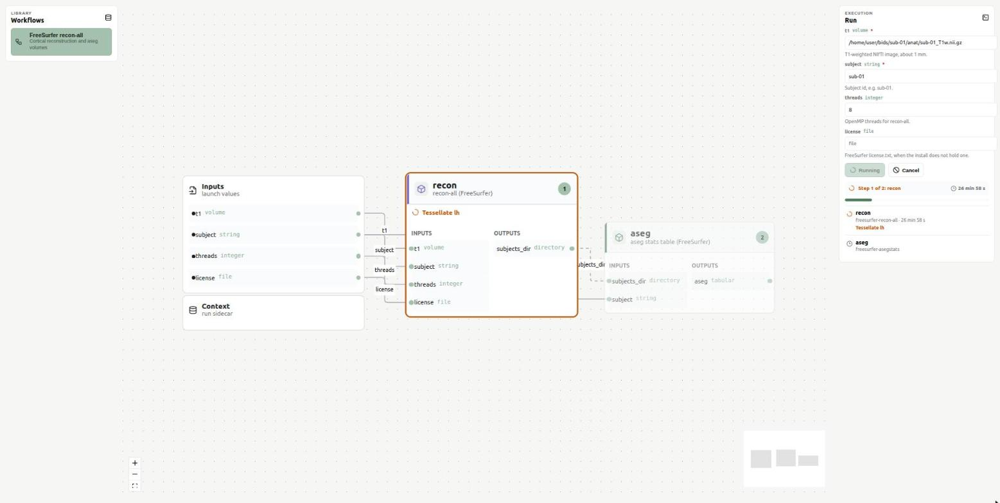
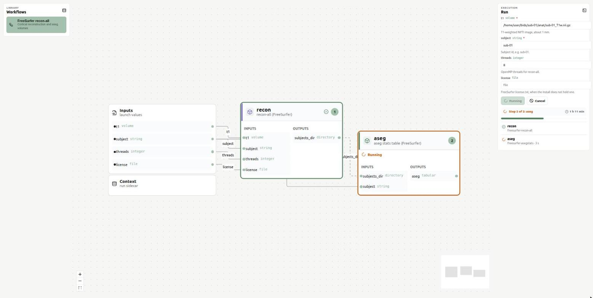
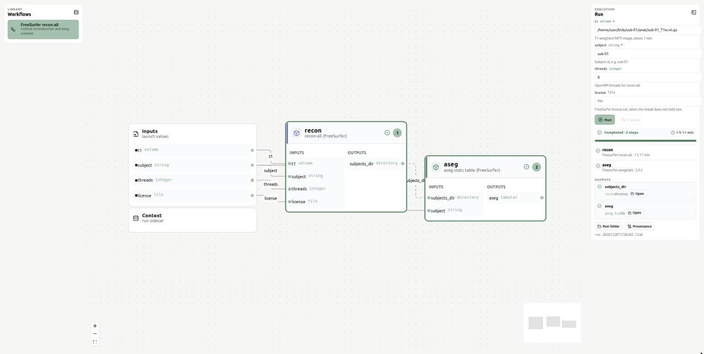
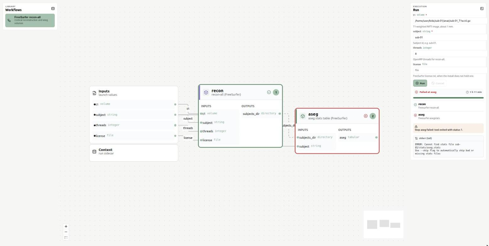

# Run monitoring

While a workflow runs, `@medview/neuroflow-react` shows where it is, in two places:

- **Run panel:** the current step, its stage, how long the run and the step have
  been going, and a progress bar that moves within the step.
- **Diagram:** each step node is ringed by its state. Running is amber, with the
  current stage under the header; finished is green, with a check; failed is red,
  with a cross. Steps not yet reached are dimmed.

The screenshots below show a full `freesurfer-recon-all` run (ds000001 sub-01,
FreeSurfer 8.2.0, 8 threads), using the times measured on that run.

Step 1, 27 minutes in, at recon-all's `Tessellate lh` stage:



Step 2 running, after 1 h 11 min of recon-all:



Completed, with each step's duration from `run.json`:



Failed at step 2, with the error and the step's stderr tail:



## Where the stage comes from

1. **The tool reports stages.** Each step gets `NEUROFLOW_PROGRESS_FILE` (see the
   [session contract](neuroflow-session-contract.md)). The tool, or its adapter,
   appends JSON lines to it:
   ```json
   {"stage": "Tessellate lh", "fraction": 0.378}
   ```
   `fraction` is how far through the step this stage starts, from 0 to 1. It can
   be left out; the stage is still shown.
2. **Native CLI tools use the `progress` template field.** It matches stage lines
   in the command's stdout (see [native CLI tools](native-cli-tools.md)). For
   recon-all, that's its dated `#@# <stage> <date>` lines, with the fraction for
   each of 55 stages measured on the run above.
3. **The runtime forwards changes.** `neuroflow-mcp` polls the file while the step
   runs. It sends each change as an MCP progress notification:
   - `progress` is `<step index> + fraction`, so the bar moves within the step;
   - `message` is the step label plus the stage:
     ```text
     step 1/2: recon (neuroflow.gallery.tools/freesurfer-recon-all): Tessellate lh
     ```
   Fractions never go backwards and stay below 1. The step's own end completes it.
4. **The UI parses the message.** `parseProgressMessage` (exported by the package)
   reads the step, tool and stage from it. `stepRunStates(workflow, run)` turns a
   `HostRunState` into each step's state. `RunPanel` and `PipelineView` do both
   for you; a host that draws its own `WorkflowDiagram` passes
   `runStates={stepRunStates(workflow, run)}`.

Hosts that already parse `step i/n: <step>` keep working. The stage is a suffix
after the tool id, and runs whose tools report no stages produce the same
messages as before.
